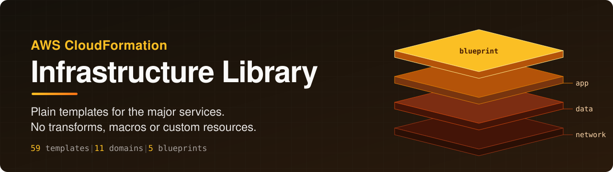
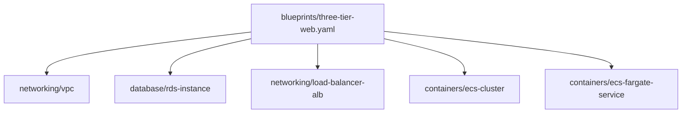

<div align="center">



# AWS CloudFormation Infrastructure Library

**Plain CloudFormation building blocks for the major AWS services, and blueprints that combine them into complete stacks.**

<a href="https://github.com/CoinClubQuincy/AWS-CloudFormation-Infrastructure-Library/actions/workflows/cfn-lint.yml"></a>
<a href="LICENSE"></a>


[What is included](#what-is-included) · [Deploy one template](#deploy-one-template) · [Deploy a blueprint](#deploy-a-blueprint) · [Catalog](docs/CATALOG.md) · [Conventions](docs/CONVENTIONS.md)

</div>

| 59 templates | 11 domains | 5 blueprints | 0 custom resources |
|:---:|:---:|:---:|:---:|
| Each one stands alone | From networking to analytics | Nested stacks, ready to package | No transforms, macros or helper code |

- **Safe defaults.** Encrypted, private and tagged, with no secrets passed as parameters.
- **Cost is written down.** The [catalog](docs/CATALOG.md) says what each template bills while idle.
- **Composable.** Stacks publish their outputs as exports, and blueprints wire templates together by relative path.

> [!IMPORTANT]
> Every template passes `cfn-lint`, a convention checker and a Checkov scan, but **these checks read
> the templates; they do not deploy them**. The library has not yet been deployed to a real account
> as a whole. Test in a sandbox account first, using [`scripts/smoke_test.sh`](scripts/smoke_test.sh).

## What is included

| Domain | Templates |
|---|---|
| `analytics` | Athena workgroup, Firehose to S3, Glue crawler, Kinesis stream, MSK Serverless, OpenSearch, Redshift Serverless |
| `cicd` | CodeBuild project, CodePipeline from GitHub to a CloudFormation change set |
| `compute` | Auto Scaling group, Batch on Fargate, EC2 instance with SSM access, Lambda function |
| `containers` | ECR repository, ECS cluster, ECS Fargate service, EKS cluster, EKS managed node group |
| `database` | Aurora cluster, DocumentDB, DynamoDB, ElastiCache Serverless for Valkey, RDS instance, RDS Proxy |
| `edge` | ACM certificate, CloudFront with a private S3 origin, WAF web ACL |
| `integration` | API Gateway HTTP and REST APIs, EventBridge rule and scheduler, SNS topic, SQS queue, Step Functions |
| `networking` | ALB, NLB, Route 53 public and private zones, Transit Gateway, VPC, VPC interface endpoints |
| `observability` | Alarm topic, budget, dashboard, log group |
| `security` | Access Analyzer, CloudTrail, Cognito, AWS Config, GuardDuty, GitHub OIDC role, IAM service role, KMS key, Secrets Manager secret, Security Hub |
| `storage` | AWS Backup plan, EFS, S3 bucket, S3 log bucket |

| Blueprint | What it builds |
|---|---|
| [`static-site`](blueprints/static-site.yaml) | Private S3 site behind CloudFront, with an optional web ACL |
| [`serverless-api`](blueprints/serverless-api.yaml) | HTTP API, Lambda function and DynamoDB table with scoped access |
| [`container-service`](blueprints/container-service.yaml) | New VPC, HTTPS load balancer and a Fargate service |
| [`three-tier-web`](blueprints/three-tier-web.yaml) | Load balancer, Fargate service and an RDS database in isolated subnets |
| [`data-lake`](blueprints/data-lake.yaml) | S3 fed by Firehose, cataloged by Glue and queried with Athena |

### How a blueprint fits together

`three-tier-web` is a parent stack that nests five templates from this library:



## Deploy one template

```sh
aws cloudformation deploy \
  --stack-name orders-queue \
  --template-file templates/integration/sqs-queue.yaml \
  --parameter-overrides ProjectName=orders Environment=dev
```

Add `--capabilities CAPABILITY_IAM` to templates that create IAM roles. Stacks publish their outputs
as exports named `<stack name>-<output name>`, so other stacks can import them.

## Deploy a blueprint

Blueprints reference templates by relative path, so package them first. `package` uploads the nested
templates to an S3 bucket you own and writes a deployable copy:

```sh
aws cloudformation package \
  --template-file blueprints/static-site.yaml \
  --s3-bucket my-artifact-bucket \
  --output-template-file packaged.yaml

aws cloudformation deploy \
  --stack-name my-site \
  --template-file packaged.yaml \
  --capabilities CAPABILITY_IAM \
  --parameter-overrides ProjectName=mysite Environment=prod
```

## Before you deploy

- **Check the cost.** Each template's `Metadata.Library.Cost` says what bills while idle. NAT gateways,
  load balancers, EKS control planes and database instances all cost money with no traffic.
- **Expect some resources to survive deletion.** Stateful resources use `DeletionPolicy: Retain` or
  `Snapshot`, so deleting a stack leaves them behind, and they keep billing until you remove them.
- **Set the runtime and engine versions you want.** Defaults such as `python3.13` or a database engine
  version age over time, and availability varies by region.
- **One-per-account services.** GuardDuty, Security Hub, AWS Config and the GitHub OIDC provider each
  allow one per account or region, and will fail if already present.

## Quality gates

CI runs all of these on every pull request, and any finding fails the build:

| Gate | What it proves |
|---|---|
| `cfn-lint` | Templates match the CloudFormation schema, with warnings blocking |
| [`scripts/check_library.py`](scripts/check_library.py) | Library rules: tags, data protection, no secrets, no hardcoded IDs, least-privilege IAM, restricted ingress, and that blueprints reference real parameters and outputs |
| [`scripts/test_checker.py`](scripts/test_checker.py) | The checker itself catches defects, using deliberately broken templates |
| Checkov | Security scan: **337 passed, 0 failed, 26 skipped**. Each skipped check has a written reason in [`docs/SECURITY-SCAN.md`](docs/SECURITY-SCAN.md) |

Run them locally:

```sh
pip install cfn-lint==1.59.0 checkov==3.4.0
cfn-lint --template 'templates/**/*.yaml'
cfn-lint --ignore-checks W3002 --template 'blueprints/*.yaml'
python scripts/check_library.py
python scripts/test_checker.py
checkov -d templates --config-file .checkov.yaml
```

To add a template, read [`docs/CONVENTIONS.md`](docs/CONVENTIONS.md), then regenerate the catalog with
`python scripts/check_library.py --write-catalog`.

## Older templates

The original templates are in [`legacy/`](legacy/). They are unsupported and kept for reference, so
prefer the versions in `templates/` for anything new.

## License

Apache-2.0. See [LICENSE](LICENSE).
